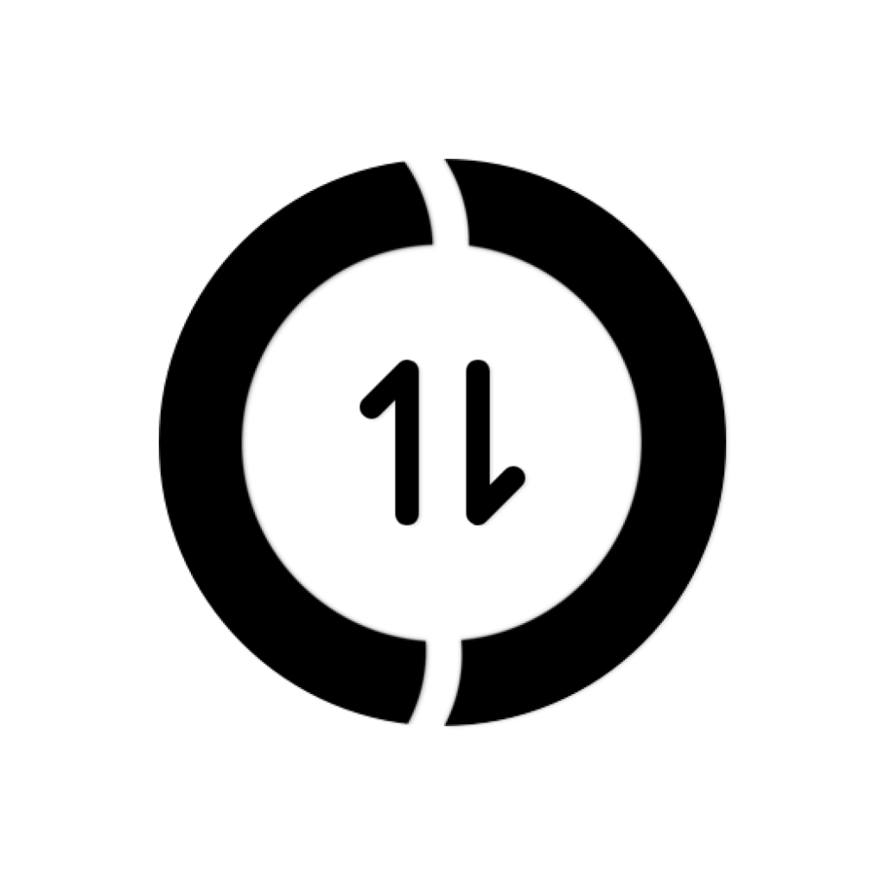

# AlonaBot OneBot 11 Adapter

[简体中文](README.zh-CN.md)

<p align="center">
  
</p>

Connect OneBot 11 implementations over forward or reverse Universal WebSocket, including media and recursive forwarded messages.

## Quick start

Use Core v0.3.0 or later. On the machine running Core:

```fish
alonabot install --source AlonaBot/alonabot-adapter-onebot11 --yes
```

Add a OneBot11 account and configure its forward or reverse connection.

## Documentation

- [Usage and configuration](docs/usage.md)
- [Development and checks](docs/development.md)
- [Packaging and releases](docs/releasing.md)
- [Core documentation](https://github.com/AlonaBot/AlonaBot/blob/main/docs/index.md)

## Contributing

[Contribution guide](CONTRIBUTING.md)

## License

[MIT](LICENSE)

The [OneBot logo](https://github.com/botuniverse/onebot/blob/d533f0fca3bd14781d4461776dba8d907d9de253/specs/assets/images/logo.png) is by OneBot Community and is used unchanged under the MIT License; its copyright notice is included in [LICENSE](LICENSE).
